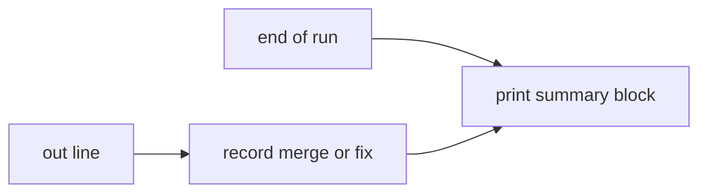

# Execution Plan - Driver prints a stop summary

> Every requirement must be traceable to a user story or acceptance criterion.

**Skill:** [plan](../../ravintio-zero/skills/ravintio-plan/SKILL.md)
**Feature:** 0000511-driver-stop-summary
**Version:** 0.111.0
**Status:** active

## Active Skills

| Skill | Scope | Purpose |
|-------|-------|---------|
| none | plan | No capability skill applies |

## Functional Requirements Directory

Functional requirements are split into individual files, one user story per file, at `plan/current/requirements/`.

| File | Requirement |
|------|------------|
| [req-001-print-merged-and-fixes.md](requirements/req-001-print-merged-and-fixes.md) | The driver prints the merged steps and its fixes at each end of a run |
| [req-002-print-the-action-left.md](requirements/req-002-print-the-action-left.md) | The driver prints the one action left for the human |
| [req-003-docs-state-the-summary.md](requirements/req-003-docs-state-the-summary.md) | The driver header, the standards, and an ADR state the summary |

## Non-Functional Requirements

| ID | Category | Requirement | Target | Measurement |
|----|----------|------------|--------|-------------|
| NFR-001 | Safety | The summary never changes an exit code and never throws | Exit codes 0, 1, and 75 match the old driver in the tests | The new test file |

## API Summary

No API changes.

## Data Model Summary

| Entity | Owner Component | Key Fields | Relationships |
|--------|----------------|------------|--------------|
| Run record (in memory) | ravintio-zero | merged steps, fixes, pending delivery | Filled by `out()` and read by the summary printer |

## Component Interactions

## Test impact

| Cause | Test | Unit |
|-------|------|------|
| Backlog entry ids 0000512 and 0000532 | none found | U3 |
| New test file | `test-0000164-req-008-no-process-substitution-loops.sh` | U1 |
| Driver output gains lines | none found | U2 |
| Reference file edit | none found | U3 |

## Branch-point reads

| File | Commit read | Unit |
|------|-------------|------|
| `src/ravintio-zero/scripts/initiative-run.mjs` | 2d4c4977 | U2 |
| `src/ravintio-zero/standards/roadmap-standards.md` | 2d4c4977 | U3 |
| `docs/decisions-index.md` | 2d4c4977 | U3 |
| `docs/adr/0341-driver-stop-summary.md` | new | U3 |
| `src/ravintio-zero/tests/test-0000511-req-001-003-stop-summary.sh` | new | U1 |

## Concurrency plan

| Unit | Depends on | Writes | Batch | Sequential reason | Shared resources |
|------|-----------|--------|-------|-------------------|------------------|
| U1 | none | `src/ravintio-zero/tests/test-0000511-req-001-003-stop-summary.sh` | 1 | Tests first: the tests fail before U2 starts | none |
| U2 | U1 | `src/ravintio-zero/scripts/initiative-run.mjs` | 2 | none | none |
| U3 | U1 | `src/ravintio-zero/standards/roadmap-standards.md`, `docs/adr/0341-driver-stop-summary.md`, `docs/decisions-index.md` | 2 | none | none |
| U4 | U2, U3 | `ravintio-zero/` | 3 | It copies the files that U2 and U3 write | none |

## Assumptions

| ID | Assumption | Impact if Wrong |
|----|-----------|----------------|
| A-001 | The existing merge and fix lines name every merge and fix | The summary omits a fix, and the full output still holds it |
| A-002 | A stop line decides the action | The generic action still points at the stop line |

## Open Questions

None.
