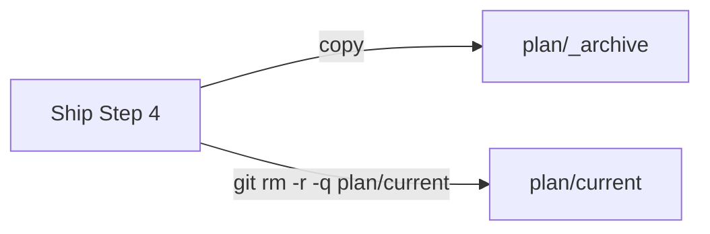

# Execution Plan - Ship removal needs human approval

> Every requirement traces to a user story.

**Skill:** [plan](../skills/ravintio-plan/SKILL.md)
**Feature:** 0000519-ship-removal-needs-human-approval
**Version:** 0.101.0
**Status:** active

## Active Skills

None.

## Functional Requirements Directory

| File | Requirement |
|------|------------|
| [req-001-ship-removal-command.md](requirements/req-001-ship-removal-command.md) | Ship removes plan/current with git rm |
| [req-002-p2-docs-timing.md](requirements/req-002-p2-docs-timing.md) | P2 writes docs outside the suite run |

## Non-Functional Requirements

| ID | Category | Requirement | Target | Measurement |
|----|----------|------------|--------|-------------|
| NFR-001 | Size | All skill text stays under its line cap | 1,720 lines or fewer | `test-0000391-req-008-standard-text.sh` |

## API Summary

No API.

## Data Model Summary

No data store.

## Component Interactions

## Test impact

| Cause | Test | Unit |
|-------|------|------|
| Skill-text budget | `test-0000206-req-002-step-application.sh`, `test-0000383-req-001-005-test-impact-causes.sh`, `test-0000391-req-008-standard-text.sh` cap all skills at 1,720 lines. Now 1,683 | U-1, U-2 |
| Size cap | none, the change edits neither the orchestrator nor a skill a cap test measures by bytes | U-1, U-2 |
| Reference file edit | none, the change edits no `references/` file | U-1, U-2 |
| Pinned lines | `test-0000025-req-002-ship-agent-p7-git-add.sh` pins `Copy all of \`plan/current/\` to the archive path, then delete`. `test-0000385-req-001-affected-tests.sh` pins `one full suite run`, `before P2 completes`, and `background` | U-1, U-2 |
| Backlog entry id 0000518 | none found | U-1 |
| New test file | repo-wide style tests, such as `test-0000164-req-008` | U-1, U-2 |
| Non-suite file | none, the change adds only `test-*.sh` suites | U-1, U-2 |

## Branch-point reads

| File | Commit read | Unit |
|------|-------------|------|
| src/ravintio-zero/skills/ravintio-ship/SKILL.md | 840f6336 | U-1 |
| src/ravintio-zero/skills/ravintio-implement/SKILL.md | c952df2c | U-2 |
| docs/architecture-overview.md | 140887d0 | U-3 |
| docs/decisions-index.md | 140887d0 | U-3 |
| docs/adr/0319-ship-removes-plan-current-with-git-rm.md | new | U-3 |

## Concurrency plan

U-1 is the ship edit and its pin suite. U-2 is the implement edit and its pin suite. U-3 is the living docs.

| Unit | Depends on | Writes | Batch | Sequential reason | Shared resources |
|------|-----------|--------|-------|-------------------|------------------|
| U-1 | none | src/ravintio-zero/skills/ravintio-ship/SKILL.md, src/ravintio-zero/tests/test-0000519-req-001-ship-removal-command.sh | 1 | none | none |
| U-2 | none | src/ravintio-zero/skills/ravintio-implement/SKILL.md, src/ravintio-zero/tests/test-0000519-req-002-p2-docs-timing.sh | 1 | none | none |
| U-3 | U-1, U-2 | docs/, plan/changelog/ | 2 | depends on the final wording | none |

## Assumptions

| ID | Assumption | Impact if Wrong |
|----|-----------|----------------|
| A-001 | The safety check accepts `git rm -r -q plan/current`. | The step stops again at Step 4. |

## Open Questions

None.
