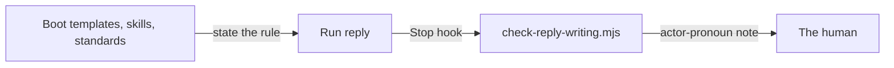

# Execution Plan - Replies name actors by role

> Every requirement traces to a user story.

**Skill:** [plan](../skills/ravintio-plan/SKILL.md)
**Feature:** 0000521-replies-name-actors-by-role
**Version:** 0.103.0
**Status:** active

## Active Skills

None.

## Functional Requirements Directory

| File | Requirement |
|------|------------|
| [req-001-actor-names-in-conventions.md](requirements/req-001-actor-names-in-conventions.md) | Actor names in the reply conventions |
| [req-002-reply-hook-flags-pronouns.md](requirements/req-002-reply-hook-flags-pronouns.md) | Reply hook flags I and you |
| [req-003-initiative-report-heading.md](requirements/req-003-initiative-report-heading.md) | Initiative report heading |

## Non-Functional Requirements

| ID | Category | Requirement | Target | Measurement |
|----|----------|------------|--------|-------------|
| NFR-001 | Size | The orchestrator skill stays under its byte cap | 9000 bytes or fewer | `test-0000247-req-001-stage-by-path.sh` |
| NFR-002 | Size | All skill text stays under its line cap | 1,720 lines or fewer | `test-0000391-req-008-standard-text.sh` |
| NFR-003 | Safety | The reply hook exits 0 on every input | exit code 0 | `test-0000390-req-005-advisory-reply-check.sh` |

## API Summary

No API.

## Data Model Summary

No data store.

## Component Interactions

## Test impact

| Cause | Test | Unit |
|-------|------|------|
| Skill-text budget | `test-0000206-req-002-step-application.sh`, `test-0000383-req-001-005-test-impact-causes.sh`, `test-0000391-req-008-standard-text.sh` cap all skills at 1,720 lines. Now 1,683 | U-1 |
| Size cap | `test-0000151-req-011-orchestrator-references-split.sh` and `test-0000247-req-001-stage-by-path.sh` cap the orchestrator at 9000 bytes. Now 8987 | U-1 |
| Pinned lines | `test-0000200-req-001-002-reply-conventions.sh` pins the reporting rule text in the boot file and the orchestrator. `test-0000450-req-004-report-format.sh` pins `Decisions for you` | U-1 |
| Boot file regeneration | `test-0000029-req-001-003-boot-file-regeneration.sh`, `test-0000379-req-007-worktree-rule.sh`, and `test-0000468-req-002-read-the-clock-rule.sh` read the boot templates | U-1 |
| Hook tests | `test-0000390-req-005-advisory-reply-check.sh` and `test-0000390-req-005-setup-wires-the-hook.sh` read the reply hook | U-2 |
| Fixture-pinned line | none found in `tests/fixtures/` for the edited lines | U-1, U-2 |
| Backlog entry id 0000522 | none found | U-1 |
| New test file | repo-wide style tests, such as `test-0000164-req-008` | U-1, U-2 |
| Non-suite file | none, the change adds only `test-*.sh` suites | U-1, U-2 |

## Branch-point reads

| File | Commit read | Unit |
|------|-------------|------|
| src/ravintio-zero/templates/standard-boot.md | ae9dfaee | U-1 |
| src/ravintio-zero/templates/codex-boot.md | ae9dfaee | U-1 |
| src/ravintio-zero/skills/ravintio-orchestrator/SKILL.md | 140887d0 | U-1 |
| src/ravintio-zero/skills/ravintio-initiative/SKILL.md | 56515396 | U-1 |
| src/ravintio-zero/standards/roadmap-standards.md | 56515396 | U-1 |
| src/ravintio-zero/tests/test-0000450-req-004-report-format.sh | 86bed28b | U-1 |
| src/ravintio-zero/hooks/enforcement/check-reply-writing.mjs | c952df2c | U-2 |
| docs/architecture-overview.md | 7c2a8186 | U-3 |
| docs/decisions-index.md | 7c2a8186 | U-3 |

## Concurrency plan

U-1 is the conventions text, the heading, and their pin suite. U-2 is the hook rule and its suite. U-3 is the living docs.

| Unit | Depends on | Writes | Batch | Sequential reason | Shared resources |
|------|-----------|--------|-------|-------------------|------------------|
| U-1 | none | src/ravintio-zero/templates/standard-boot.md, src/ravintio-zero/templates/codex-boot.md, src/ravintio-zero/skills/ravintio-orchestrator/SKILL.md, src/ravintio-zero/skills/ravintio-initiative/SKILL.md, src/ravintio-zero/standards/roadmap-standards.md, src/ravintio-zero/tests/test-0000450-req-004-report-format.sh, src/ravintio-zero/tests/test-0000521-req-001-003-actor-names.sh | 1 | none | none |
| U-2 | none | src/ravintio-zero/hooks/enforcement/check-reply-writing.mjs, src/ravintio-zero/tests/test-0000521-req-002-actor-pronoun-hook.sh | 1 | none | none |
| U-3 | U-1, U-2 | docs/, plan/changelog/ | 2 | depends on the final wording | none |

## Assumptions

| ID | Assumption | Impact if Wrong |
|----|-----------|----------------|
| A-001 | A run reply opens with `hh:mm` and a run prefix. | The hook skips a reply it should check. |

## Open Questions

None.
