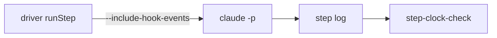

# Execution Plan - Step sessions receive the clock

> Every requirement must be traceable to a user story or acceptance criterion.

**Skill:** [plan](../../ravintio-zero/skills/ravintio-plan/SKILL.md)
**Feature:** 0000534-step-sessions-receive-clock
**Version:** 0.112.0
**Status:** active

## Active Skills

| Skill | Scope | Purpose |
|-------|-------|---------|
| none | plan | No capability skill applies |

## Functional Requirements Directory

Functional requirements are split into individual files, one user story per file, at `plan/current/requirements/`.

| File | Requirement |
|------|------------|
| [req-001-driver-records-hook-events.md](requirements/req-001-driver-records-hook-events.md) | The driver starts every step session with `--include-hook-events` |
| [req-002-clock-check.md](requirements/req-002-clock-check.md) | A script fails a step log with tool calls and no clock output |
| [req-003-docs-state-the-check.md](requirements/req-003-docs-state-the-check.md) | The driver header, the standards, and an ADR state the flag, the check, and the proof |

## Non-Functional Requirements

| ID | Category | Requirement | Target | Measurement |
|----|----------|------------|--------|-------------|
| NFR-001 | Safety | The check writes no file and prints no log text | 0 files written, 0 log lines printed | The new test file |

## API Summary

No API changes.

## Data Model Summary

| Entity | Owner Component | Key Fields | Relationships |
|--------|----------------|------------|--------------|
| Step log | ravintio-zero | stream-json events, now with hook events | Written by the driver and read by the watcher and the check |

## Component Interactions

## Test impact

| Cause | Test | Unit |
|-------|------|------|
| Backlog entry id 0000535 | none found | U3 |
| New test file | `test-0000164-req-008-no-process-substitution-loops.sh` | U1 |
| Driver arguments gain a flag | `helpers/driver-args.sh`, `test-0000240-req-001-driver-stream-args.sh`, `test-0000444-req-001-003-queue-items.sh` | U1 |
| Reference file edit | none found | U3 |
| Fixture-pinned line | none found | U3 |

## Branch-point reads

| File | Commit read | Unit |
|------|-------------|------|
| `src/ravintio-zero/scripts/initiative-run.mjs` | 4fc98fe8 | U2 |
| `src/ravintio-zero/standards/roadmap-standards.md` | 4fc98fe8 | U3 |
| `docs/decisions-index.md` | 4fc98fe8 | U3 |
| `src/ravintio-zero/scripts/step-clock-check.mjs` | new | U2 |
| `docs/adr/0342-step-sessions-receive-the-clock.md` | new | U3 |
| `src/ravintio-zero/tests/test-0000534-req-001-003-step-clock.sh` | new | U1 |

## Concurrency plan

| Unit | Depends on | Writes | Batch | Sequential reason | Shared resources |
|------|-----------|--------|-------|-------------------|------------------|
| U1 | none | `src/ravintio-zero/tests/test-0000534-req-001-003-step-clock.sh`, `src/ravintio-zero/tests/helpers/driver-args.sh`, `src/ravintio-zero/tests/test-0000444-req-001-003-queue-items.sh` | 1 | Tests first: the tests fail before U2 starts | none |
| U2 | U1 | `src/ravintio-zero/scripts/initiative-run.mjs`, `src/ravintio-zero/scripts/step-clock-check.mjs` | 2 | none | none |
| U3 | U1 | `src/ravintio-zero/standards/roadmap-standards.md`, `docs/adr/0342-step-sessions-receive-the-clock.md`, `docs/decisions-index.md`, `src/ravintio-zero/tests/README.md` | 2 | none | none |
| U4 | U2, U3 | `ravintio-zero/` | 3 | It copies the files that U2 and U3 write | none |

## Assumptions

| ID | Assumption | Impact if Wrong |
|----|-----------|----------------|
| A-001 | The proof run represents a step session | The check on a real step log still shows the gap |
| A-002 | The machine zone explains the step 48 time | The check on the next step log shows whether the clock arrived |

## Open Questions

None.
