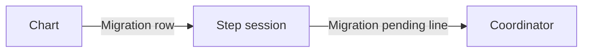

# Execution Plan - Pending migrations reach the human early

> Every requirement traces to a user story.

**Skill:** [plan](../skills/ravintio-plan/SKILL.md)
**Feature:** 0000536-pending-migrations-reach-the-human-early
**Version:** 0.113.0
**Status:** active

## Active Skills

None.

## Functional Requirements Directory

| File | Requirement |
|------|------------|
| [req-001-chart-lists-pending-migrations.md](requirements/req-001-chart-lists-pending-migrations.md) | Chart lists each pending migration and records the answer |
| [req-002-step-records-and-carries-on.md](requirements/req-002-step-records-and-carries-on.md) | A step runs a row's migration or logs it and carries on |
| [req-003-coordinator-raises-recorded-migrations.md](requirements/req-003-coordinator-raises-recorded-migrations.md) | The coordinator raises each logged migration |

## Non-Functional Requirements

| ID | Category | Requirement | Target | Measurement |
|----|----------|------------|--------|-------------|
| NFR-001 | Size | The initiative skill stays under its line cap. | Fewer than 120 lines | `wc -l` in test 0000314 |
| NFR-002 | Size | Skill text stays under the total cap. | 1720 lines or fewer | `wc -l` in test 0000314 |

## API Summary

None. The feature builds no API.

## Data Model Summary

None. The feature adds one `## Decisions` row form and one build-log line form.

## Component Interactions

## Test impact

| Cause | Test | Unit |
|-------|------|------|
| Skill-text budget | `test-0000314-req-002-driver-files-stay.sh`, `test-0000399-req-003-004-question-rule.sh` | U-1 |
| Reference file edit | `test-0000243-req-005-short-rule.sh`, `test-0000151-req-011-orchestrator-references-split.sh` | U-2 |
| Mirrored tree | `test-0000493-req-004-handoff-text.sh` needs `src/ravintio-zero/` to match `ravintio-zero/`. | U-1, U-2, U-4 |
| Fixture-pinned line | `fixtures/0000243-resume-detection-base.md` holds the old check 1 line. Keep it verbatim. | U-2 |
| Backlog entry id | none found | none |
| New test file | `test-0000164-req-008-no-process-substitution-loops.sh` | U-4 |

## Branch-point reads

| File | Commit read | Unit |
|------|-------------|------|
| `ravintio-zero/skills/ravintio-initiative/SKILL.md` | f39459b7 | U-1 |
| `ravintio-zero/standards/roadmap-standards.md` | 4fc98fe8 | U-1 |
| `ravintio-zero/skills/ravintio-orchestrator/references/orchestrator-resume-detection.md` | 2adff7e3 | U-2 |
| `ravintio-zero/skills/ravintio-migrator/SKILL.md` | 9ab9500b | U-2 |
| `ravintio-zero/tests/test-0000536-req-001-003-pending-migrations.sh` | new | U-4 |
| `docs/decisions-index.md` | 4fc98fe8 | U-3 |
| `docs/architecture-overview.md` | b9e8e826 | U-3 |

## Concurrency plan

| Unit | Depends on | Writes | Batch | Sequential reason | Shared resources |
|------|-----------|--------|-------|-------------------|------------------|
| U-4 | none | `ravintio-zero/tests/test-0000536-req-001-003-pending-migrations.sh` | 1 | Red phase runs first and alone | none |
| U-1 | U-4 | initiative skill, roadmap standards | 2 | Both edits share one rule text | none |
| U-2 | U-4 | resume-detection reference, migrator skill | 2 | none | none |
| U-3 | U-1, U-2 | `docs/decisions-index.md`, `docs/architecture-overview.md` | 3 | Living docs follow the code edits | none |

## Assumptions

| ID | Assumption | Impact if Wrong |
|----|-----------|----------------|
| A-001 | The human approved each migration that has a `Migration:` row, at chart time. | A migration runs unreviewed. |

## Open Questions

None.
