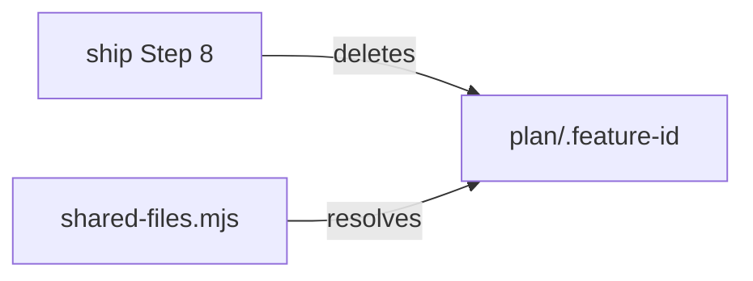

# Execution Plan - Ship leaves plan/.feature-id behind

> Every requirement traces to a user story or acceptance criterion.

**Skill:** [plan](../../ravintio-zero/skills/ravintio-plan/SKILL.md)
**Feature:** 0000545-clear-feature-id-at-ship
**Version:** 0.115.0
**Status:** active

## Active Skills

| Skill | Scope | Purpose |
|-------|-------|---------|
| ravintio-implement | plan | Runs the TDD loop |

## Functional Requirements Directory

Functional requirements live at `plan/current/requirements/`.

| File | Requirement |
|------|------------|
| [req-001-ship-deletes-feature-id.md](requirements/req-001-ship-deletes-feature-id.md) | Step 8 deletes the id file |
| [req-002-queue-resolves-feature-id.md](requirements/req-002-queue-resolves-feature-id.md) | The queue resolves the id file |
| [req-003-remove-tracked-feature-id.md](requirements/req-003-remove-tracked-feature-id.md) | The PR removes the tracked file |

## Non-Functional Requirements

| ID | Category | Requirement | Target | Measurement |
|----|----------|------------|--------|-------------|
| NFR-001 | Compatibility | Existing suites still pass | 0 new failures beyond the baseline | Full suite |

## API Summary

None. The change builds no API.

## Data Model Summary

None. The change stores no data.

## Component Interactions

## Test impact

| Cause | Test | Unit |
|-------|------|------|
| Backlog entry id 0000514 | none found | U1 |
| Reference file edit: none | none found | U1 |
| Skill-text budget: ship SKILL.md edit | test-0000023-req-002-marker-commit-lifecycle.sh, test-0000151-req-002-ship-sentinels-before-pr.sh, test-0000452-req-001-archive-after-ci.sh | U1 |
| Fixture-pinned line | tests/fixtures/0000151-orchestrator-skill-base.md | U1 |
| Shared-files edit | test-0000456-req-001-shared-files.sh, test-0000481-req-001-regenerate.sh, test-0000485-req-001-id-collisions.sh | U2 |
| New test file | test-0000164-req-008 style tests, run-tests.sh | U1, U2 |

## Branch-point reads

| File | Commit read | Unit |
|------|-------------|------|
| src/ravintio-zero/skills/ravintio-ship/SKILL.md | 05445700 (local) | U1 |
| src/ravintio-zero/scripts/shared-files.mjs | da687860 (local) | U2 |
| plan/.feature-id | tracked at the base | U3 |
| ravintio-zero/tests/test-0000545-req-001-ship-deletes-feature-id.sh | new | U1 |
| ravintio-zero/tests/test-0000545-req-002-queue-resolves-feature-id.sh | new | U2 |

## Concurrency plan

| Unit | Depends on | Writes | Batch | Sequential reason | Shared resources |
|------|-----------|--------|-------|-------------------|------------------|
| U1 | none | src/ravintio-zero/skills/ravintio-ship/SKILL.md, ravintio-zero/skills/ravintio-ship/SKILL.md, ravintio-zero/tests/test-0000545-req-001-ship-deletes-feature-id.sh | 1 | none | none |
| U2 | none | src/ravintio-zero/scripts/shared-files.mjs, ravintio-zero/scripts/shared-files.mjs, ravintio-zero/tests/test-0000545-req-002-queue-resolves-feature-id.sh | 1 | none | none |
| U3 | U1, U2 | plan/.feature-id removal | 2 | The removal follows the code that handles it | none |
| U4 | U3 | docs/ files the run changes | 3 | The docs describe the finished change | none |

## Assumptions

| ID | Assumption | Impact if Wrong |
|----|-----------|----------------|
| A-001 | A step session writes its own `plan/.feature-id` at P0 when none exists. | A fresh step reports a missing id file. |

## Open Questions

None.
