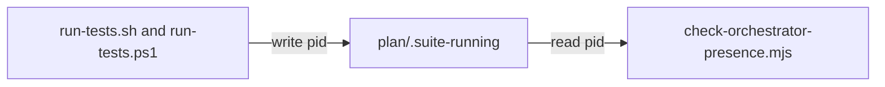

# Execution Plan - Strict-mode ack write mid-suite fails the suite run

> Every requirement must be traceable to a user story or acceptance criterion.

**Skill:** [plan](../skills/ravintio-plan/SKILL.md)
**Feature:** 0000548-ack-write-mid-suite-fails-run
**Version:** 0.115.0
**Status:** active

## Active Skills

| Skill | Scope | Purpose |
|-------|-------|---------|
| ravintio-implement | plan | TDD loop for REQ-001 |

## Functional Requirements Directory

| File | Requirement |
|------|------------|
| [req-001-suite-marker-and-quiet-hook.md](requirements/req-001-suite-marker-and-quiet-hook.md) | Runners mark a live run and the strict hook stays quiet for a step session |

## Non-Functional Requirements

| ID | Category | Requirement | Target | Measurement |
|----|----------|------------|--------|-------------|
| NFR-001 | Security | The hook still demands an ack outside a live run | 0 quiet prompts without a step session and a live pid | Suite cases in the new test |

## API Summary

None. The feature adds no endpoint.

## Data Model Summary

| Entity | Owner Component | Key Fields | Relationships |
|--------|----------------|------------|--------------|
| plan/.suite-running | ravintio-zero | runner pid | read by the strict hook |

## Component Interactions

## Test impact

| Cause | Test | Unit |
|-------|------|------|
| Backlog entry id 0000476 | none found | U1 |
| New test file | `test-0000164-req-008-no-process-substitution-loops.sh` and the other 0000164 style suites | U1 |
| Non-suite file | none, the new test is a suite | U1 |
| Fixture-pinned line | `test-0000205-req-002-ack-and-trigger-hooks.sh`, `test-0000315-req-002-003-final-tree-check.sh`, `test-0000251-req-001-runners-clear-step-variable.sh`, `test-0000185-req-001-strict-mode-section.sh` | U1, U2 |

## Branch-point reads

| File | Commit read | Unit |
|------|-------------|------|
| src/ravintio-zero/hooks/enforcement/check-orchestrator-presence.mjs | a1d31cee | U1 |
| src/ravintio-zero/tests/run-tests.sh | f2abdc14 | U2 |
| src/ravintio-zero/tests/run-tests.ps1 | f2abdc14 | U2 |
| .gitignore | d1ced4e7 | U2 |
| src/ravintio-zero/standards/hook-enforcement.md | 709dc92d | U3 |
| src/ravintio-zero/tests/README.md | c557f904 | U3 |
| src/ravintio-zero/tests/test-0000548-req-001-suite-marker.sh | new | U1 |

## Concurrency plan

| Unit | Depends on | Writes | Batch | Sequential reason | Shared resources |
|------|-----------|--------|-------|-------------------|------------------|
| U1 | none | hook, new test | 1 | The test drives the runner change in U2, so TDD runs red to green in order | none |
| U2 | U1 | run-tests.sh, run-tests.ps1, .gitignore | 2 | Needs the red test from U1 | none |
| U3 | U2 | docs/, README, component.yml, mirror | 3 | Documents the built behaviour | none |

## Assumptions

| ID | Assumption | Impact if Wrong |
|----|-----------|----------------|
| A-001 | The runner and the hook share one repo root | The prompt still arrives mid-run and the run fails as before |

## Open Questions

| ID | Question | Blocking |
|----|----------|----------|
| none | none | none |
