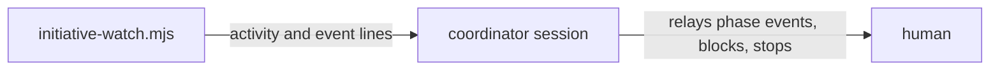

# Execution Plan - Initiative skills do not micromanage

> Every requirement traces to a user story and an acceptance criterion.

**Skill:** [plan](../../ravintio-zero/skills/ravintio-plan/SKILL.md)
**Feature:** 0000553-coordinator-oversight-not-micromanagement
**Version:** 0.119.0
**Status:** active

## Active Skills

| Skill | Scope | Purpose |
|-------|-------|---------|
| none | plan | No capability skill applies. |

## Functional Requirements Directory

| File | Requirement |
|------|------------|
| [req-001-relay-at-events.md](requirements/req-001-relay-at-events.md) | The skill relays watcher lines only at phase events, blocks, and stops |
| [req-002-test-output-after-stop.md](requirements/req-002-test-output-after-stop.md) | The skill reads step test output only after a stop |

## Non-Functional Requirements

| ID | Category | Requirement | Target | Measurement |
|----|----------|------------|--------|-------------|
| NFR-001 | Maintainability | The initiative skill stays under its line cap. | fewer than 120 lines | `test-0000314-req-002-driver-files-stay.sh` |

## API Summary

None. The feature edits skill text.

## Data Model Summary

| Entity | Owner Component | Key Fields | Relationships |
|--------|----------------|------------|--------------|
| `skills/ravintio-initiative/SKILL.md` | ravintio-zero | Reports section | read by the coordinator session |

## Component Interactions

## Test impact

| Cause | Test | Unit |
|-------|------|------|
| Skill count | none found | U-001 |
| Skill-text budget | `test-0000314-req-002-driver-files-stay.sh`, `test-0000399-req-003-004-question-rule.sh`, and `test-0000536-req-001-003-pending-migrations.sh` cap the skill at fewer than 120 lines. It has 117. The unit adds no more than 2 net lines. | U-001 |
| Size cap | none found | U-001 |
| Backlog entry id (0000530) | none found | U-001 |
| Workflow job or step edit | none found | U-001 |
| Reference file edit | none found | U-001 |
| New test file | the unit adds `test-0000553-req-001-002-oversight.sh`. Repo-wide style tests such as `test-0000164-req-008` read it. | U-001 |
| Non-suite file | none found | U-001 |
| Fixture-pinned line | none found in `ravintio-zero/tests/fixtures/` | U-001 |
| Existing suite that pins the old relay text | `test-0000240-req-002-activity-lines.sh` req-005 AC-1 asserts `Relay each one` on the activity line of the skill. The unit updates it. | U-001 |
| Existing suite that pins text near the edit | `test-0000450-req-004-report-format.sh` asserts `I-C Run: event:`, `Decisions for the human`, and `Routine fixes made`. The edit keeps all three. | U-001 |
| Standards line that repeats the relay rule | `ravintio-zero/standards/roadmap-standards.md` line 465 says the skill relays each activity line. The unit changes it. | U-003 |

## Branch-point reads

| File | Commit read | Unit |
|------|-------------|------|
| `src/ravintio-zero/skills/ravintio-initiative/SKILL.md` | d813df28 | U-001 |
| `ravintio-zero/skills/ravintio-initiative/SKILL.md` | d813df28 | U-001 |
| `src/ravintio-zero/tests/test-0000240-req-002-activity-lines.sh` | c269f565 | U-001 |
| `ravintio-zero/tests/test-0000240-req-002-activity-lines.sh` | 67cf6a7e | U-001 |
| `src/ravintio-zero/tests/test-0000553-req-001-002-oversight.sh` | new | U-001 |
| `ravintio-zero/tests/test-0000553-req-001-002-oversight.sh` | new | U-001 |
| `src/ravintio-zero/standards/roadmap-standards.md` | 78dd05cb | U-003 |
| `ravintio-zero/standards/roadmap-standards.md` | 78dd05cb | U-003 |
| `docs/architecture-overview.md` | 21bdc55e | U-003 |

## Concurrency plan

| Unit | Depends on | Writes | Batch | Sequential reason | Shared resources |
|------|-----------|--------|-------|-------------------|------------------|
| U-001 | none | both trees of `SKILL.md`, the 0000240 suite, and the new suite | 1 | Alone in the batch. REQ-001 and REQ-002 edit one section of one file. | none |
| U-003 | U-001 | both trees of `roadmap-standards.md`, `docs/architecture-overview.md` | 2 | Documents the final skill text. | none |

## Assumptions

| ID | Assumption | Impact if Wrong |
|----|-----------|----------------|
| A-001 | Stops print their own `Blocked:` and `Stopping:` lines. | The coordinator misses a stop. |

## Open Questions

None.
