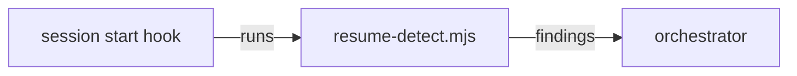

# Execution Plan - A step session finds an unfinished step

> Every requirement must be traceable to a user story or acceptance criterion.

**Skill:** [plan](../skills/ravintio-plan/SKILL.md)
**Feature:** 0000556-step-session-finds-unfinished-step
**Version:** 0.130.0
**Status:** active

## Active Skills

| Skill | Scope | Purpose |
|-------|-------|---------|
| none | plan | none |

## Functional Requirements Directory

Functional requirements are split into individual files, one user story per file, at `plan/current/requirements/`.

| File | Requirement |
|------|------------|
| [req-001-unfinished-step-finding.md](requirements/req-001-unfinished-step-finding.md) | Resume detection finds a step session with no build log and no archive |

## Non-Functional Requirements

| ID | Category | Requirement | Target | Measurement |
|----|----------|------------|--------|-------------|
| NFR-001 | Safety | The script prints no repo text and exits 0 | exit code 0 | the resume-detect suites |

## API Summary

None. The feature builds no API.

## Data Model Summary

None. The feature adds no data.

## Component Interactions

## Test impact

| Cause | Test | Unit |
|-------|------|------|
| Backlog entry id 0000531 | none found | U2 |
| Output order | test-0000243-req-001-002-006-resume-detect.sh, test-0000555-req-003-resume-finding.sh | U2 |
| Reference file edit | test-0000151-req-011-orchestrator-references-split.sh, test-0000243-req-005-short-rule.sh | U2 |
| Pack file edit | test-0000493-req-004-handoff-text.sh | U2 |
| New test file | test-0000164-req-008-no-process-substitution-loops.sh | U1 |
| Fixture-pinned line | none found | U2 |

## Branch-point reads

| File | Commit read | Unit |
|------|-------------|------|
| src/ravintio-zero/scripts/resume-detect.mjs | a256a338 | U2 |
| ravintio-zero/scripts/resume-detect.mjs | a256a338 | U2 |
| src/ravintio-zero/skills/ravintio-orchestrator/references/orchestrator-resume-detection.md | a256a338 | U2 |
| ravintio-zero/skills/ravintio-orchestrator/references/orchestrator-resume-detection.md | a256a338 | U2 |
| docs/architecture-overview.md | a256a338 | U3 |
| ravintio-zero/tests/test-0000556-req-001-unfinished-step-finding.sh | new | U1 |

## Concurrency plan

| Unit | Depends on | Writes | Batch | Sequential reason | Shared resources |
|------|-----------|--------|-------|-------------------|------------------|
| U1 | none | ravintio-zero/tests/test-0000556-req-001-unfinished-step-finding.sh | 1 | The test goes first so it can fail | none |
| U2 | U1 | src/ravintio-zero/scripts/resume-detect.mjs, ravintio-zero/scripts/resume-detect.mjs, the reference in both trees | 2 | The code makes the test pass | none |
| U3 | U2 | docs/architecture-overview.md | 3 | Living docs follow the code | none |

## Assumptions

| ID | Assumption | Impact if Wrong |
|----|-----------|----------------|
| A-001 | The feature id is the branch name without its prefix. | The finding misses a step. |

## Open Questions

None.
