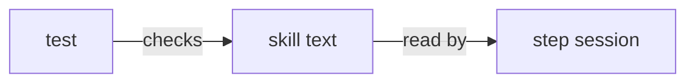

# Execution Plan - Step sessions wait on a suite without matching their own shell

> Every requirement must be traceable to a user story or acceptance criterion.

**Skill:** [plan](../skills/ravintio-plan/SKILL.md)
**Feature:** 0000557-self-matching-pgrep-wait
**Version:** 0.133.0
**Status:** active

## Active Skills

| Skill | Scope | Purpose |
|-------|-------|---------|
| none | plan | none |

## Functional Requirements Directory

Functional requirements are split into individual files, one user story per file, at `plan/current/requirements/`.

| File | Requirement |
|------|------------|
| [req-001-safe-suite-wait.md](requirements/req-001-safe-suite-wait.md) | Skills name the safe wait and a test bans `pgrep -f` |

## Non-Functional Requirements

| ID | Category | Requirement | Target | Measurement |
|----|----------|------------|--------|-------------|
| NFR-001 | Maintainability | The validate skill stays within its size cap | 200 lines or fewer | test-0000391-req-008-standard-text.sh |

## API Summary

None. The feature builds no API.

## Data Model Summary

None. The feature adds no data.

## Component Interactions

## Test impact

| Cause | Test | Unit |
|-------|------|------|
| Backlog entry id 0000532 | none found | U2 |
| Skill-text budget | test-0000383-req-001-005-test-impact-causes.sh (total 1720 lines) | U3 |
| Size cap | test-0000391-req-008-standard-text.sh (validate 200 lines) | U3 |
| Reference file edit | test-0000151-req-011-orchestrator-references-split.sh | U2 |
| Pack file edit | test-0000493-req-004-handoff-text.sh | U2, U3 |
| New test file | test-0000164-req-008-no-process-substitution-loops.sh | U1 |
| Fixture-pinned line | test-0000385-req-002-baseline-failures.sh pins the p0-start-baseline rule text | U2 |
| Prose rewrite | none found, the units add lines and rewrite none | U2, U3 |
| Pack content | none found, the run adds no content file | U1 |

## Branch-point reads

| File | Commit read | Unit |
|------|-------------|------|
| src/ravintio-zero/skills/ravintio-orchestrator/references/orchestrator-p0-start-actions.md | 1e1e0421 | U2 |
| ravintio-zero/skills/ravintio-orchestrator/references/orchestrator-p0-start-actions.md | 1e1e0421 | U2 |
| src/ravintio-zero/skills/ravintio-validate-and-accept/SKILL.md | c269f565 | U3 |
| ravintio-zero/skills/ravintio-validate-and-accept/SKILL.md | 6bc409da | U3 |
| docs/architecture-overview.md | b1903e7c | U4 |
| ravintio-zero/tests/test-0000557-req-001-safe-suite-wait.sh | new | U1 |

## Concurrency plan

| Unit | Depends on | Writes | Batch | Sequential reason | Shared resources |
|------|-----------|--------|-------|-------------------|------------------|
| U1 | none | ravintio-zero/tests/test-0000557-req-001-safe-suite-wait.sh | 1 | The test goes first so it can fail | none |
| U2 | U1 | the P0 start actions reference in both trees | 2 | none | none |
| U3 | U1 | the validate-and-accept skill in both trees | 2 | none | none |
| U4 | U2, U3 | docs/architecture-overview.md | 3 | Living docs follow the text | none |

## Assumptions

| ID | Assumption | Impact if Wrong |
|----|-----------|----------------|
| A-001 | Skill and standard text is the only place that tells a session how to wait. | A script keeps the bad loop. |

## Open Questions

None.
