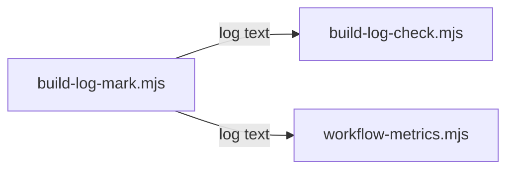

# Execution Plan - Log a non-TDD unit with a class

> Every requirement traces to a user story or acceptance criterion.

**Skill:** [plan](../skills/ravintio-plan/SKILL.md)
**Feature:** 0000580-log-non-tdd-units
**Version:** 0.151.0
**Status:** active

## Active Skills

None.

## Functional Requirements Directory

| File | Requirement |
|------|------------|
| [req-001-docs-class-in-standards.md](requirements/req-001-docs-class-in-standards.md) | The standards name class `docs`, its tier row, and its marker rule |
| [req-002-class-on-markers.md](requirements/req-002-class-on-markers.md) | `build-log-mark.mjs` writes markers that carry a class |
| [req-003-check-accepts-docs.md](requirements/req-003-check-accepts-docs.md) | Check 7 requires both markers for a `docs` unit |
| [req-004-metrics-docs-row.md](requirements/req-004-metrics-docs-row.md) | The metrics report counts `docs` units in their own row |

## Non-Functional Requirements

| ID | Category | Requirement | Target | Measurement |
|----|----------|------------|--------|-------------|
| NFR-001 | Compatibility | An older `Done:` line still passes check 7 and counts as `unclassified` | 0 new findings on a log with no class fields | `test-0000358` and `test-0000386-req-003` pass |

## API Summary

None. The feature builds no API.

## Data Model Summary

None. The feature changes the text format of build log lines only.

## Component Interactions

## Test impact

| Cause | Test | Unit |
|-------|------|------|
| Pack file edit | `test-0000493-req-004-handoff-text.sh` | U-001 |
| Prose rewrite (the class sentence and the `Done:` line) | `test-0000386-req-002-unit-class-tier-effort.sh`, `test-0000043-req-012-progress-markers-and-resume.sh` | U-001 |
| Output order (marker line form) | `test-0000575-req-001-marker-script.sh`, `test-0000358-req-002-003-build-log-checks.sh` | U-002, U-003 |
| Output order (metrics rows) | `test-0000386-req-003-metrics-by-class-and-tier.sh`, `test-0000173-req-001-workflow-metrics-script.sh` | U-004 |
| New test file | `test-0000164-req-008-no-process-substitution-loops.sh` | U-001, U-002, U-003, U-004 |
| Fixture-pinned line | none found | U-001 |
| Backlog entry id | none found for 0000410 | U-005 |
| Regression copies | none found in `ravintio-zero/tests/regression/` | U-001 |

## Branch-point reads

Base `origin/initiative/0000544-priority-backlog` at 1b8907e7. `git fetch` failed in the sandbox, so the rows read the local tracking ref.

| File | Commit read | Unit |
|------|-------------|------|
| `src/ravintio-zero/standards/agent-dispatch-standards.md` | 1b8907e7 local | U-001 |
| `ravintio-zero/standards/agent-dispatch-standards.md` | 1b8907e7 local | U-001 |
| `src/ravintio-zero/templates/build-log.template.md` | c269f565 local | U-001 |
| `ravintio-zero/templates/build-log.template.md` | b9eb2a8a local | U-001 |
| `src/ravintio-zero/scripts/build-log-mark.mjs` | e163440d local | U-002 |
| `ravintio-zero/scripts/build-log-mark.mjs` | e163440d local | U-002 |
| `src/ravintio-zero/scripts/build-log-check.mjs` | 3020593c local | U-003 |
| `ravintio-zero/scripts/build-log-check.mjs` | 3020593c local | U-003 |
| `src/ravintio-zero/scripts/workflow-metrics.mjs` | 6606109c local | U-004 |
| `ravintio-zero/scripts/workflow-metrics.mjs` | 6606109c local | U-004 |
| `docs/architecture-overview.md` | 1b8907e7 local | U-005 |
| `docs/decisions-index.md` | 1595cdcb local | U-005 |
| `ravintio-zero/tests/test-0000580-req-001-docs-class.sh` and its `src/` copy | new | U-001 |
| `ravintio-zero/tests/test-0000580-req-002-class-on-markers.sh` and its `src/` copy | new | U-002 |
| `ravintio-zero/tests/test-0000580-req-003-check-docs-unit.sh` and its `src/` copy | new | U-003 |
| `ravintio-zero/tests/test-0000580-req-004-metrics-docs-row.sh` and its `src/` copy | new | U-004 |

## Concurrency plan

| Unit | Depends on | Writes | Batch | Sequential reason | Shared resources |
|------|-----------|--------|-------|-------------------|------------------|
| U-001 | none | standards and build-log template in both trees, `test-0000580-req-001` in both trees | 1 | none | none |
| U-002 | none | `build-log-mark.mjs` in both trees, `test-0000580-req-002` in both trees | 1 | none | none |
| U-003 | none | `build-log-check.mjs` in both trees, `test-0000580-req-003` in both trees | 1 | none | none |
| U-004 | none | `workflow-metrics.mjs` in both trees, `test-0000580-req-004` in both trees | 1 | none | none |
| U-005 | U-001, U-002, U-003, U-004 | `docs/architecture-overview.md`, `docs/decisions-index.md`, `docs/adr/0353-docs-class-for-units-with-no-test.md`, `plan/changelog/` | 2 | The docs describe the finished units | none |

U-005 is the living docs unit. It is a docs unit with no executable check, so it logs `RED:` and `GREEN:` lines with class `docs` and names 0000410.

## Assumptions

| ID | Assumption | Impact if Wrong |
|----|-----------|----------------|
| A-001 | The `docs` tier row matches the `content` row. | A docs unit runs on the wrong model tier. |

## Open Questions

None.
