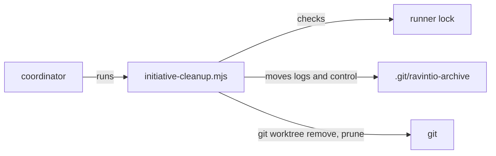

# Execution Plan - Delivery cleans up driver state

> Every requirement traces to a user story in the brief.

**Skill:** [plan](../skills/ravintio-plan/SKILL.md)
**Feature:** 0000581-delivery-cleans-up-driver-state
**Version:** 0.151.0
**Status:** active

## Active Skills

| Skill | Scope | Purpose |
|-------|-------|---------|
| none | none | none |

## Functional Requirements Directory

| File | Requirement |
|------|------------|
| [req-001-refuse-while-driver-runs.md](requirements/req-001-refuse-while-driver-runs.md) | The script changes nothing while the lock exists. |
| [req-002-archive-logs-and-control.md](requirements/req-002-archive-logs-and-control.md) | The script moves the logs and control folders to `.git/ravintio-archive/`. |
| [req-003-remove-worktrees-report-queue.md](requirements/req-003-remove-worktrees-report-queue.md) | The script removes the worktrees and reports each queue item. |
| [req-004-status-reads-zero-after-cleanup.md](requirements/req-004-status-reads-zero-after-cleanup.md) | A cleaned root reads zero in the status script. |
| [req-005-delivery-text-names-cleanup.md](requirements/req-005-delivery-text-names-cleanup.md) | The standard and the skill name the cleanup. |

## Non-Functional Requirements

| ID | Category | Requirement | Target | Measurement |
|----|----------|------------|--------|-------------|
| NFR-001 | Safety | The script removes no path outside the repo root | 0 paths removed outside the repo | test for REQ-003 AC-1 and the 0000583 scan |
| NFR-002 | Reliability | A failed removal never stops the run | 0 stops on a failed removal | test for REQ-003 AC-3 |
| NFR-003 | Security | The script refuses a symlink at each path it touches | 0 symlinks followed | test for REQ-002 AC-3 |
| NFR-004 | Size | The initiative skill stays under 120 lines | at most 119 lines | tests 0000205 REQ-004 and 0000314 REQ-002 |

## API Summary

No API change.

## Data Model Summary

No data model change.

## Component Interactions

## Test impact

| Cause | Test | Unit |
|-------|------|------|
| Skill-text budget | test-0000205-req-004-initiative-skill.sh, test-0000314-req-002-driver-files-stay.sh, test-0000313-req-002-initiative-skill-setup-stop.sh, test-0000318-req-001-002-coordinator-prs.sh, test-0000319-req-003-delivery-check.sh, test-0000353-req-005-006-delivery-and-ship.sh (each caps the skill under 120 lines, and 0000314 caps all skill text at 1720 lines) | U-002 |
| Size cap | the same six tests. The lowest cap is 119 lines for the initiative skill | U-002 |
| Backlog entry id 0000582 | none found | U-002 |
| Pack file edit | test-0000493-req-004-handoff-text.sh | U-001 |
| Pack file edit | test-0000493-req-004-handoff-text.sh | U-002 |
| New test file | test-0000164-req-008-no-process-substitution-loops.sh, run-tests.sh, run-tests.ps1 | U-001 |
| New test file | test-0000164-req-008-no-process-substitution-loops.sh, run-tests.sh, run-tests.ps1 | U-002 |
| Output order | none found | U-001 |
| Fixture-pinned line | none found | U-002 |
| Reference file edit: roadmap-standards.md | test-0000043-req-008-roadmap-delivery.sh, test-0000353-req-005-006-delivery-and-ship.sh, test-0000205-req-004-initiative-skill.sh | U-002 |
| Pack content | test-0000042-req-010-pack-wording-allowlist.sh | U-002 |
| Temp-folder scan | test-0000583-req-003-nothing-deleted-outside-repo.sh scans pack scripts for removals in a shared temp folder | U-001 |
| Regression copy of a pinned test | none found | U-002 |

## Branch-point reads

Base: `origin/initiative/0000544-priority-backlog`, at `1b8907e7`.

| File | Commit read | Unit |
|------|-------------|------|
| src/ravintio-zero/scripts/initiative-cleanup.mjs | new | U-001 |
| src/ravintio-zero/tests/test-0000581-req-001-004-cleanup-script.sh | new | U-001 |
| src/ravintio-zero/standards/roadmap-standards.md | 1b8907e7 | U-002 |
| src/ravintio-zero/skills/ravintio-initiative/SKILL.md | 1b8907e7 | U-002 |
| src/ravintio-zero/tests/test-0000581-req-005-delivery-text.sh | new | U-002 |
| src/ravintio-zero/component.yml | 1b8907e7 | U-003 |
| docs/architecture-overview.md | 1b8907e7 | U-003 |
| docs/adr/0354-delivery-archives-driver-state-in-the-git-folder.md | new | U-003 |

## Concurrency plan

| Unit | Depends on | Writes | Batch | Sequential reason | Shared resources |
|------|-----------|--------|-------|-------------------|------------------|
| U-001 | none | src/ravintio-zero/scripts/initiative-cleanup.mjs, ravintio-zero/scripts/initiative-cleanup.mjs, src/ravintio-zero/tests/test-0000581-req-001-004-cleanup-script.sh, ravintio-zero/tests/test-0000581-req-001-004-cleanup-script.sh | 1 | none | none |
| U-002 | none | src/ravintio-zero/standards/roadmap-standards.md, ravintio-zero/standards/roadmap-standards.md, src/ravintio-zero/skills/ravintio-initiative/SKILL.md, ravintio-zero/skills/ravintio-initiative/SKILL.md, src/ravintio-zero/tests/test-0000581-req-005-delivery-text.sh, ravintio-zero/tests/test-0000581-req-005-delivery-text.sh | 1 | none | none |
| U-003 | U-001, U-002 | component.yml, docs/architecture-overview.md, docs/adr/0353, docs/decisions-index.md | 2 | The docs name what U-001 and U-002 built | none |

Each unit edits `src/ravintio-zero/` and mirrors the change to `ravintio-zero/`.

## Assumptions

| ID | Assumption | Impact if Wrong |
|----|-----------|----------------|
| A-001 | The coordinator runs the script from the main working tree | The worktree removal misses the repo and prints `Kept:` |

## Open Questions

| ID | Question | Blocking |
|----|----------|----------|
| none | none | none |
