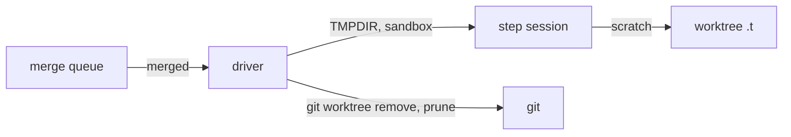

# Execution Plan - Give each step session a private temp folder

> Every requirement traces to a user story in the brief.

**Skill:** [plan](../skills/ravintio-plan/SKILL.md)
**Feature:** 0000583-step-temp-cleanup-after-merge
**Version:** 0.146.0
**Status:** active

## Active Skills

| Skill | Scope | Purpose |
|-------|-------|---------|
| none | none | none |

## Functional Requirements Directory

| File | Requirement |
|------|------------|
| [req-001-private-step-temp-folder.md](requirements/req-001-private-step-temp-folder.md) | Each step session gets a private temp folder, the sandbox, and a worktree removal after the merge. |
| [req-002-suites-remove-temp-folders-on-exit.md](requirements/req-002-suites-remove-temp-folders-on-exit.md) | Five suites, the git-isolation helper, and the runner remove temp folders on every exit. |
| [req-003-nothing-deleted-outside-repo.md](requirements/req-003-nothing-deleted-outside-repo.md) | The driver deletes nothing outside the repo. |
| [req-004-scratch-under-tmpdir.md](requirements/req-004-scratch-under-tmpdir.md) | Scratch goes under `$TMPDIR`. |

## Non-Functional Requirements

| ID | Category | Requirement | Target | Measurement |
|----|----------|------------|--------|-------------|
| NFR-001 | Safety | The driver deletes nothing outside the repo | 0 paths removed outside the repo | test for REQ-003 AC-1 |
| NFR-002 | Reliability | A failed worktree removal never stops the run | 0 stops on a failed removal | `Kept:` line in `removeMergedWorktree` |
| NFR-003 | Security | The session writes only to three folders | sandbox `allowWrite` holds 3 paths | test for REQ-001 AC-2 |

## API Summary

No API change.

## Data Model Summary

No data model change.

## Component Interactions

## Test impact

| Cause | Test | Unit |
|-------|------|------|
| Backlog entry id 0000584 | none found | U-001 |
| Pack file edit | test-0000493-req-004-handoff-text.sh | U-001 |
| Pack file edit | test-0000493-req-004-handoff-text.sh | U-002 |
| Reference file edit: roadmap-standards.md rule | test-0000501-req-001-004-sweep.sh, test-0000509-req-001-003-clear-ready.sh, test-0000511-req-001-003-stop-summary.sh | U-003 |
| Output order | none found | U-001 |
| New test file | test-0000164-req-008-no-process-substitution-loops.sh, run-tests.sh, run-tests.ps1 | U-001 |
| New test file | test-0000164-req-008-no-process-substitution-loops.sh, run-tests.sh, run-tests.ps1 | U-002 |
| Pack content | test-0000042-req-010-pack-wording-allowlist.sh | U-003 |
| Fixture-pinned line | none found | U-003 |
| Helper edit: git-isolation.sh | test-0000462-req-001-git-identity-isolation.sh | U-002 |
| Regression copy of a pinned test | none found | U-002 |

## Branch-point reads

Base: `origin/initiative/0000544-priority-backlog`.

| File | Commit read | Unit |
|------|-------------|------|
| src/ravintio-zero/scripts/initiative-run.mjs | a256a338 | U-001 |
| src/ravintio-zero/tests/test-0000583-req-001-private-step-temp.sh | new | U-001 |
| src/ravintio-zero/tests/test-0000169-req-004-setup-attribution-setting.sh | c269f565 | U-002 |
| src/ravintio-zero/tests/test-0000245-req-002-targeted-overrides.sh | c269f565 | U-002 |
| src/ravintio-zero/tests/test-0000151-req-005-setup-write-error-line.sh | c269f565 | U-002 |
| src/ravintio-zero/tests/test-0000171-req-004-no-skill-bundling.sh | 462e7100 | U-002 |
| src/ravintio-zero/tests/test-0000029-req-001-003-boot-file-regeneration.sh | c269f565 | U-002 |
| src/ravintio-zero/tests/helpers/git-isolation.sh | f2abdc14 | U-002 |
| src/ravintio-zero/tests/test-0000583-req-002-suites-remove-temp-on-exit.sh | new | U-002 |
| src/ravintio-zero/standards/roadmap-standards.md | 1cb863ae | U-003 |
| src/ravintio-zero/component.yml | 3020593c | U-003 |
| docs/architecture-overview.md | local | U-003 |

## Concurrency plan

| Unit | Depends on | Writes | Batch | Sequential reason | Shared resources |
|------|-----------|--------|-------|-------------------|------------------|
| U-001 | none | src/ravintio-zero/scripts/initiative-run.mjs, tests/test-0000583-req-001, req-003, helpers/scheduler-fixture.sh, .gitignore | 1 | none | none |
| U-002 | none | run-tests.sh, five suites, helpers/git-isolation.sh, tests/test-0000583-req-002 | 1 | none | none |
| U-003 | U-001, U-002 | roadmap-standards.md, testing-standards.md, ravintio-implement SKILL.md, component.yml, ADR-0352, docs/architecture-overview.md, tests/test-0000583-req-004 | 2 | The docs name what U-001 and U-002 built | none |

Each unit edits `src/ravintio-zero/` and mirrors the change to `ravintio-zero/`.

## Assumptions

| ID | Assumption | Impact if Wrong |
|----|-----------|----------------|
| A-001 | The sandbox keys `enabled` and `filesystem.allowWrite` work in the installed Claude Code | The session runs without the sandbox |

## Open Questions

| ID | Question | Blocking |
|----|----------|----------|
| none | none | none |
