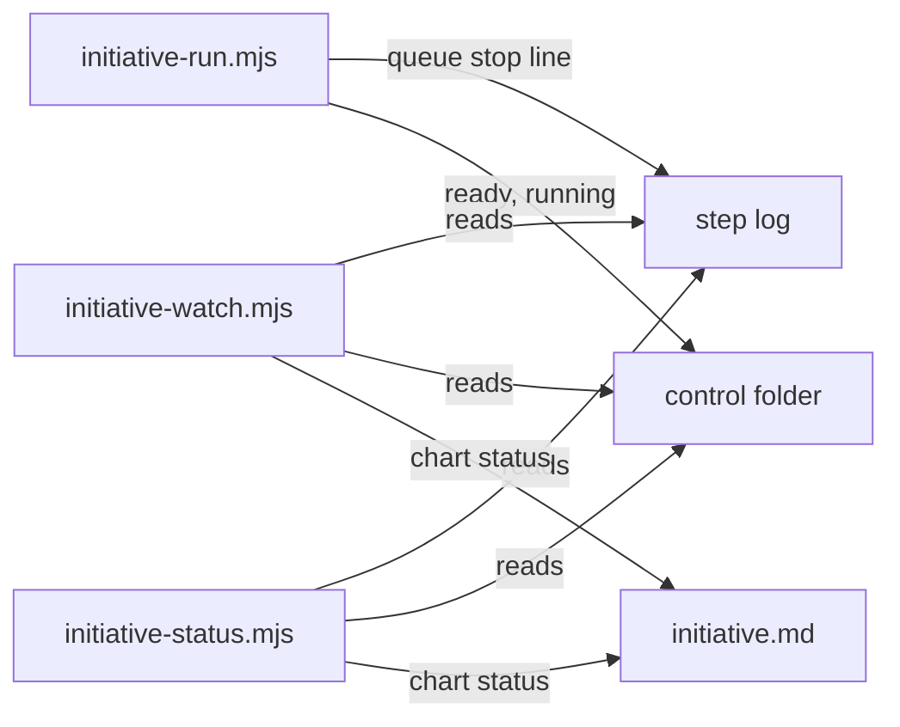

# Execution Plan - Coordinator status view

> Every requirement traces to a user story.

**Skill:** [plan](../skills/ravintio-plan/SKILL.md)
**Feature:** 0000450-coordinator-status-view
**Version:** 0.95.0
**Status:** active

## Active Skills

None.

## Functional Requirements Directory

| File | Requirement |
|------|------------|
| [req-001-status-script.md](requirements/req-001-status-script.md) | One status script for the queue, ready PRs, running steps, and live stops |
| [req-002-watcher-events.md](requirements/req-002-watcher-events.md) | Watcher events for ready, queue failure, and driver exit, with chart state |
| [req-003-driver-queue-line.md](requirements/req-003-driver-queue-line.md) | The driver prints and logs the queue failure at once |
| [req-004-report-format.md](requirements/req-004-report-format.md) | Skill report format and standards text |

## Non-Functional Requirements

| ID | Category | Requirement | Target | Measurement |
|----|----------|------------|--------|-------------|
| NFR-001 | Latency | The status script exits fast on a large chart | under 2 seconds on 60 steps | timed in the suite |
| NFR-002 | Security | The script and watcher write no file and treat file text as data | 0 files written, 0 shell strings | code review and a symlink test |

## API Summary

No API.

## Data Model Summary

No data store.

## Component Interactions

## Test impact

| Cause | Test | Unit |
|-------|------|------|
| Backlog entry id 0000428 | `test-0000189-req-008-open-backlog-entries.sh` greps open entries, re-check at P2 | U-4 |
| New test file | repo-wide style tests, such as `test-0000164-req-008` | U-1 |
| Skill edit | `test-0000205-req-004-initiative-skill.sh` and `test-0000205-req-007-stage-ownership.sh` read the initiative skill | U-4 |
| Watcher edit | `test-0000205-req-003-watch-script.sh`, `test-0000241-req-001-watcher-false-events.sh`, `test-0000354-req-005-watcher-wait.sh`, and `test-0000240-req-002-activity-lines.sh` | U-2 |
| Driver edit | `test-0000205-req-001-driver-fixes.sh`, `test-0000205-req-006-driver-final-report.sh`, and `test-0000250-req-002-driver-restart-stop.sh` | U-3 |
| Reference file edit | none found, the change edits no `references/` file | U-4 |
| Non-suite file | none, the change adds only `test-*.sh` suites | U-1 |

## Branch-point reads

| File | Commit read | Unit |
|------|-------------|------|
| src/ravintio-zero/scripts/initiative-status.mjs | new | U-1 |
| src/ravintio-zero/scripts/initiative-watch.mjs | c952df2c | U-2 |
| src/ravintio-zero/scripts/initiative-run.mjs | 84690c86 | U-3 |
| src/ravintio-zero/skills/ravintio-initiative/SKILL.md | 84690c86 | U-4 |
| src/ravintio-zero/standards/roadmap-standards.md | 4b19f29a | U-4 |
| docs/decisions-index.md | 4b19f29a | U-5 |
| docs/adr/0313-coordinator-status-view-and-events.md | new | U-5 |

## Concurrency plan

U-1 is the status script. U-2 is the watcher. U-3 is the driver line. U-4 is the skill and standards text. U-5 is the living docs.

| Unit | Depends on | Writes | Batch | Sequential reason | Shared resources |
|------|-----------|--------|-------|-------------------|------------------|
| U-1 | none | src/ravintio-zero/scripts/initiative-status.mjs, src/ravintio-zero/tests/test-0000450-req-001-status-script.sh | 1 | none | none |
| U-2 | none | src/ravintio-zero/scripts/initiative-watch.mjs, src/ravintio-zero/tests/test-0000450-req-002-watcher-events.sh | 1 | none | none |
| U-3 | none | src/ravintio-zero/scripts/initiative-run.mjs, src/ravintio-zero/tests/test-0000450-req-003-driver-queue-line.sh | 1 | none | none |
| U-4 | U-1, U-2, U-3 | src/ravintio-zero/skills/ravintio-initiative/SKILL.md, src/ravintio-zero/standards/roadmap-standards.md, src/ravintio-zero/tests/test-0000450-req-004-report-format.sh | 2 | the text describes the final behaviour | none |
| U-5 | U-4 | docs/, plan/changelog/ | 3 | depends on the final behaviour | none |

## Assumptions

| ID | Assumption | Impact if Wrong |
|----|-----------|----------------|
| A-001 | The chart `Status` column is the source of truth for merged steps. | A merged step shows as live. |
| A-002 | The queue output reaches the step log through the driver. | The watcher misses the queue event. |

## Open Questions

None.
