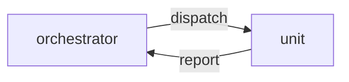

# Execution Plan - Require unit reports

> Every requirement must be traceable to a user story or acceptance criterion.

**Skill:** [plan](../skills/ravintio-plan/SKILL.md)
**Feature:** 0000573-require-unit-reports
**Version:** 0.115.0
**Status:** active

## Active Skills

| Skill | Scope | Purpose |
|-------|-------|---------|
| none | plan | none |

## Functional Requirements Directory

Functional requirements are split into individual files, one user story per file, at `plan/current/requirements/`.

| File | Requirement |
|------|------------|
| [req-001-unit-report-fields.md](requirements/req-001-unit-report-fields.md) | The unit report holds four fields and a bad one gets one resume |

## Non-Functional Requirements

| ID | Category | Requirement | Target | Measurement |
|----|----------|------------|--------|-------------|
| NFR-001 | Maintainability | Both copies of the standard match | 0 differing bytes | `diff` of the two files |

## API Summary

None. The feature builds no API.

## Data Model Summary

None. The feature adds no data.

## Component Interactions

## Test impact

| Cause | Test | Unit |
|-------|------|------|
| Backlog entry id 0000417 | none found | U1 |
| Standard text read by tests | test-0000386-req-002-unit-class-tier-effort.sh, test-0000043-req-012-progress-markers-and-resume.sh, test-0000172-req-002-fast-batches.sh | U1 |
| New test file | test-0000164-req-008-no-process-substitution-loops.sh | U2 |
| Fixture-pinned line | none found | U1 |

## Branch-point reads

| File | Commit read | Unit |
|------|-------------|------|
| src/ravintio-zero/standards/agent-dispatch-standards.md | c269f565 | U1 |
| ravintio-zero/standards/agent-dispatch-standards.md | c269f565 | U1 |
| ravintio-zero/tests/test-0000573-req-001-unit-report-fields.sh | new | U2 |

## Concurrency plan

| Unit | Depends on | Writes | Batch | Sequential reason | Shared resources |
|------|-----------|--------|-------|-------------------|------------------|
| U2 | none | ravintio-zero/tests/test-0000573-req-001-unit-report-fields.sh | 1 | The test goes first so it can fail | none |
| U1 | U2 | src/ravintio-zero/standards/agent-dispatch-standards.md, ravintio-zero/standards/agent-dispatch-standards.md | 2 | The rule makes the test pass | none |
| U3 | U1 | docs/about.md | 3 | Living docs follow the code | none |

## Assumptions

| ID | Assumption | Impact if Wrong |
|----|-----------|----------------|
| A-001 | The tests live in `ravintio-zero/tests/` only. | The test needs a second copy. |

## Open Questions

None.
