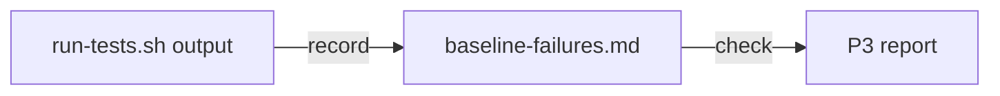

# Execution Plan - Baseline record checks its input and its file

> Every requirement traces to a user story and an acceptance criterion.

**Skill:** [plan](../../ravintio-zero/skills/ravintio-plan/SKILL.md)
**Feature:** 0000549-baseline-record-checks
**Version:** 0.115.0
**Status:** active

## Active Skills

| Skill | Scope | Purpose |
|-------|-------|---------|
| none | plan | No capability skill applies. |

## Functional Requirements Directory

| File | Requirement |
|------|------------|
| [req-001-record-needs-totals.md](requirements/req-001-record-needs-totals.md) | `record` exits 2 on input with no `Feature suites:` line |
| [req-002-check-needs-baseline.md](requirements/req-002-check-needs-baseline.md) | `check` exits 1 with `no baseline recorded` when the file is missing |

## Non-Functional Requirements

| ID | Category | Requirement | Target | Measurement |
|----|----------|------------|--------|-------------|
| NFR-001 | Reliability | Refusals use the documented exit codes. | `record` 2, `check` 1 | `test-0000385-req-002-baseline-failures.sh` |

## API Summary

None. The feature changes one command line script.

## Data Model Summary

| Entity | Owner Component | Key Fields | Relationships |
|--------|----------------|------------|--------------|
| `plan/current/baseline-failures.md` | ravintio-zero | list of suite names, or `None.` | read by P3 and ship |

## Component Interactions

## Test impact

| Cause | Test | Unit |
|-------|------|------|
| Skill count | none found | U-001 |
| Skill-text budget | none found | U-001 |
| Size cap | none found | U-001 |
| Backlog entry id (0000525, 0000515) | none found | U-001 |
| Workflow job or step edit | none found | U-001 |
| Reference file edit | none found | U-001 |
| New test file | none found, the unit edits an existing suite | U-001 |
| Non-suite file | none found | U-001 |
| Fixture-pinned line | none found | U-001 |
| Existing suite that pins the old behaviour | `ravintio-zero/tests/test-0000385-req-002-baseline-failures.sh` AC-3 pins a missing file as an empty baseline. The unit updates it. | U-002 |
| Existing suite that feeds `record` | `test-0000385-req-002-baseline-failures.sh` feeds every fixture a `Feature suites:` line, and the missing-input case exits 2 as before | U-001 |

## Branch-point reads

| File | Commit read | Unit |
|------|-------------|------|
| `src/ravintio-zero/scripts/baseline-failures.mjs` | c269f565 | U-001 |
| `ravintio-zero/scripts/baseline-failures.mjs` | c269f565 | U-001 |
| `src/ravintio-zero/tests/test-0000385-req-002-baseline-failures.sh` | c269f565 | U-001 |
| `ravintio-zero/tests/test-0000385-req-002-baseline-failures.sh` | c269f565 | U-001 |
| `src/ravintio-zero/scripts/baseline-failures.mjs` | c269f565 | U-002 |
| `ravintio-zero/scripts/baseline-failures.mjs` | c269f565 | U-002 |
| `src/ravintio-zero/tests/test-0000385-req-002-baseline-failures.sh` | c269f565 | U-002 |
| `ravintio-zero/tests/test-0000385-req-002-baseline-failures.sh` | c269f565 | U-002 |
| `docs/architecture-overview.md` | d813df28 | U-003 |
| `src/ravintio-zero/tests/README.md` | d813df28 | U-003 |
| `ravintio-zero/tests/README.md` | d813df28 | U-003 |

## Concurrency plan

| Unit | Depends on | Writes | Batch | Sequential reason | Shared resources |
|------|-----------|--------|-------|-------------------|------------------|
| U-001 | none | `baseline-failures.mjs`, `test-0000385-req-002-baseline-failures.sh`, both trees | 1 | Alone in the batch. U-002 edits the same files. | none |
| U-002 | U-001 | `baseline-failures.mjs`, `test-0000385-req-002-baseline-failures.sh`, both trees | 2 | Edits the files that U-001 edits. | none |
| U-003 | U-002 | `docs/architecture-overview.md`, `src/ravintio-zero/tests/README.md`, `ravintio-zero/tests/README.md` | 3 | Documents the final behaviour of U-001 and U-002. | none |

## Assumptions

| ID | Assumption | Impact if Wrong |
|----|-----------|----------------|
| A-001 | Every finished `run-tests.sh` run prints a `Feature suites:` line. | `record` refuses good output. |

## Open Questions

None.
