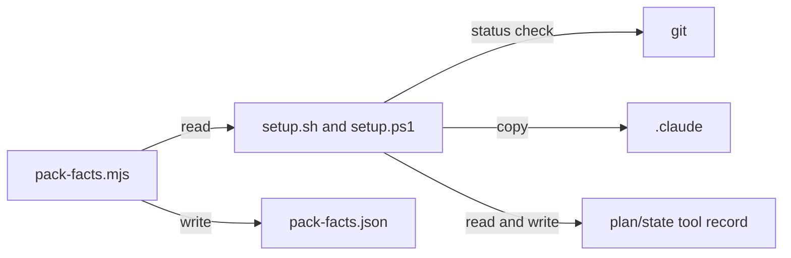

# Execution Plan - Install lifecycle

**Skill:** [plan](../../ravintio-zero/skills/ravintio-plan/SKILL.md)
**Feature:** 0000382-install-lifecycle
**Version:** 0.61.0
**Status:** active

## Active Skills

| Skill | Scope | Purpose |
|-------|-------|---------|
| none | plan | No capability skills are active |

## Functional Requirements Directory

| File | Requirement |
|------|------------|
| [req-001-update-and-doctor.md](requirements/req-001-update-and-doctor.md) | One command updates the pack and one checks the install |
| [req-002-clean-tree-check.md](requirements/req-002-clean-tree-check.md) | Setup installs only committed pack and override files |
| [req-003-uninstall.md](requirements/req-003-uninstall.md) | One command reverses setup and keeps the developer's work |
| [req-004-strict-mode-and-joining.md](requirements/req-004-strict-mode-and-joining.md) | Flags decide strict mode and a clone gets the guards |
| [req-005-clear-first-run.md](requirements/req-005-clear-first-run.md) | Help, banner, docs, and block messages |
| [req-006-pack-facts-file.md](requirements/req-006-pack-facts-file.md) | A generated facts file that CI keeps fresh |

## Non-Functional Requirements

| ID | Category | Requirement | Target | Measurement |
|----|----------|------------|--------|-------------|
| NFR-001 | Security | Uninstall removes only manifest paths and RAVINTIO-marked entries | 0 developer files removed | Test with a developer entry and file |
| NFR-002 | Parity | `setup.sh` and `setup.ps1` behave the same | 0 differing results | Paired tests |

## API Summary

No API. The setup scripts gain `--help`, `--doctor`, `--update {source}`, `--uninstall`, and `--no-strict-orchestrator`.

## Data Model Summary

`ravintio-zero/pack-facts.json` is new. It is generated and holds flags, hooks, skills, and phases. The setup manifests also record every write, including pack-owned commands.

## Component Interactions

## Test impact

| Cause | Test | Unit |
|-------|------|------|
| Skill count | none found. The run adds no skill. | none |
| Skill-text budget | none found. The run edits no `SKILL.md`. | none |
| Size cap | none found | none |
| Backlog entry id 0000283, 0000299, 0000292, 0000291, 0000298, 0000286 | none found | none |
| Workflow job or step edit | `test-0000036-req-005-windows-ci-job.sh`, `test-0000037-req-006-bash-suites-ci-job.sh`, `test-0000037-req-001-drop-telemetry-ci-job.sh`, `test-0000151-req-015-faster-powershell-ci.sh` | U6 |
| Setup usage text and flag parsing | `test-0000196-req-002-retired-flags-fail.sh`, `test-0000034-req-001-retired-flags.sh`, `test-0000185-req-001-strict-mode-section.sh`, and the `.ps1` twins | U1 |
| Setup run in a workspace | every suite that runs `setup.sh` or `setup.ps1` (about 90) | U2 |

## Concurrency plan

| Unit | Depends on | Writes | Batch | Sequential reason |
|------|-----------|--------|-------|-------------------|
| U1 | none | `setup.sh`, `setup.ps1`, `tests/test-0000382-req-004-*`, `tests/test-0000382-req-005-*` | 1 | Edits the setup scripts that every unit edits |
| U2 | U1 | `setup.sh`, `setup.ps1`, `tests/helpers/*`, existing suites, `tests/test-0000382-req-002-*` | 2 | Shared write target |
| U3 | U2 | `setup.sh`, `setup.ps1`, `tests/test-0000382-req-001-*` | 3 | Shared write target |
| U4 | U3 | `setup.sh`, `setup.ps1`, `tests/test-0000382-req-003-*` | 4 | Shared write target |
| U5 | U4 | `hooks/enforcement/*`, `getting-started.md`, `project-operations.md` | 5 | Reads the finished command names |
| U6 | U5 | `scripts/pack-facts.mjs`, `pack-facts.json`, `hooks/ravintio.yml`, `tests/test-0000382-req-006-*` | 6 | Records the finished flags and hooks |

## Assumptions

| ID | Assumption | Impact if Wrong |
|----|-----------|----------------|
| A-001 | A test workspace can commit its pack | A suite fails and gets the helper |
| A-002 | `pwsh` is on the path | PowerShell suites skip locally |

## Open Questions

None.
